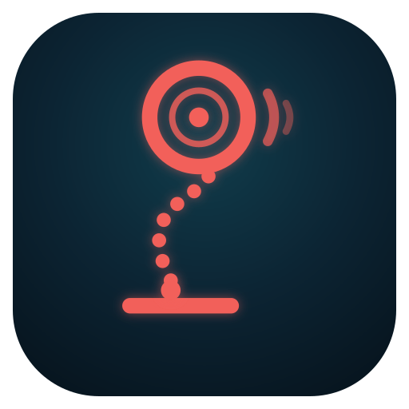

# Bar Path

Weightlifting analysis from one phone. Film a snatch or clean side-on and get the bar path, bar speed through
each stage of the lift, peak height, the catch, and a few coaching checks — on the phone, offline, nothing
uploaded. An installable web app (PWA), built for a Galaxy S23 in Chrome.



## How it works

1. **Plate.** You tap the middle of the plate nearest the camera. A circular Hough transform on colour edges
   finds its rim; a fit of the circle's centre (radius fixed within a tight band, so the plate's raised lip
   can't pull it off) follows it frame by frame. A bumper plate is 450 mm across, so its size on screen gives
   the scale — per frame, because it changes when the camera is close or tilted.
2. **Body.** MediaPipe Pose Landmarker (bundled, runs on the GPU) gives the knee and hip angles, which way the
   lifter faces, snatch vs clean, and squat vs power catch.
3. **Lift.** Positions are smoothed (10 Hz Butterworth, both directions), differentiated, and split into
   first pull → transition → second pull → turnover → recovery. The first-pull/transition split comes from
   the knees (or, without the body, from the dip in bar speed).
4. **Results.** Replay with the bar trail coloured by speed, the side-view bar path, bar speed over time,
   stage timing, checks and every measurement; CSV/JSON export.

## Filming

- Lens at hip height (~1 m), phone level — not on the floor tilted up.
- 4–5 m away with 2× zoom (portrait); the lift fills most of the frame, floor included.
- Square to the bar: the far plate hides behind the near one, which looks round.
- 1080p at 60 fps. Slow motion works too (set *Video speed* to how much it's slowed).

## Run

```bash
npm install                 # playwright-core, for tests and icons only
npm run vendor              # MediaPipe runtime + pose models into vendor/ (~33 MB, not committed)
npm run serve               # http://localhost:8765
```

On the phone (adb, wireless debugging works): `tools/phone.sh [device]` serves it as `http://localhost:8765`,
a secure origin, so the in-app camera, the service worker and *Install app* all work without HTTPS. Once
installed it runs offline; it updates whenever it can reach the server again. Share a video from the Gallery
to **Bar Path** to open it straight in the app.

## Test

```bash
npm test                                            # analysis against a known lift: 30/60/240 fps, drop-outs, mirrored
node test/synth.mjs /tmp/s.mp4                      # synthetic side-on snatch video + ground truth
node test/track.test.mjs /tmp/s.mp4                 # tracker vs truth (crop + scale per frame like the browser)
node test/analysis.test.mjs /tmp/s.mp4              # tracked → analysis vs truth
node test/e2e.mjs . /tmp/s.mp4 /tmp/s.truth.json /tmp/out          # the app in headless Chrome at S23 size
node test/e2e.mjs . real.mp4 - /tmp/out --at 11 --tap 307,551      # a real clip: scrub to the set-up, tap
```

`test/phone.mjs` runs the same flow in Chrome on the phone.

## Layout

| Path | What |
|---|---|
| `index.html`, `css/app.css` | the page; colour tokens for both themes |
| `js/app.js` | screens and flow: record/pick, mark, track, results, replay, export, install, share target |
| `js/plate.js` | plate detection and tracking |
| `js/analysis.js` | smoothing, scale, events, stages, measurements, checks |
| `js/video.js` | frames in order with true timestamps (`requestVideoFrameCallback`, adaptive rate) |
| `js/pose.js` | MediaPipe wrapper (vendor/ first, CDN fallback) |
| `js/recorder.js` | in-app recording and the spirit level |
| `js/charts.js`, `js/overlay.js` | charts; drawing on the video |
| `sw.js`, `manifest.webmanifest`, `icons/` | the installable app |
| `test/`, `tools/` | tests, synthetic video, vendor fetch, icon render, phone helper |

## Limits

One camera sees front/back and up/down only: no sideways drift, bar tilt, or left/right differences. Heights
assume the bar starts on the floor. Checks use starting thresholds meant to be tuned with a coach.

MediaPipe is Apache-2.0 (`vendor/mediapipe/LICENSE` after `npm run vendor`).
